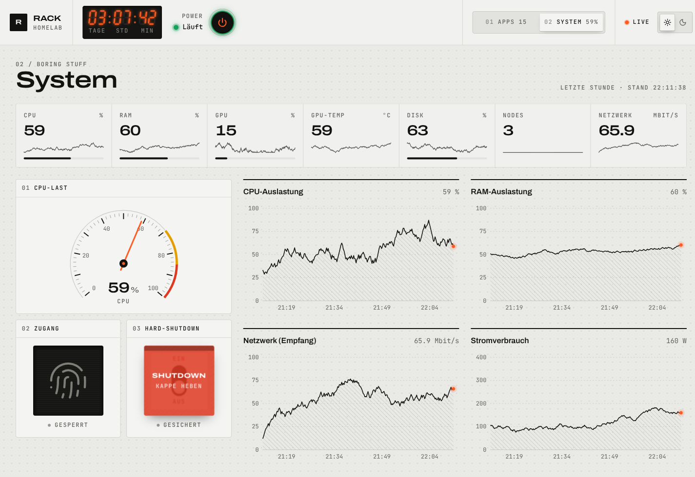
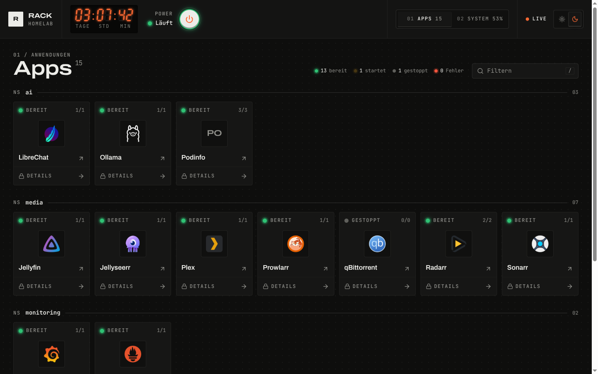
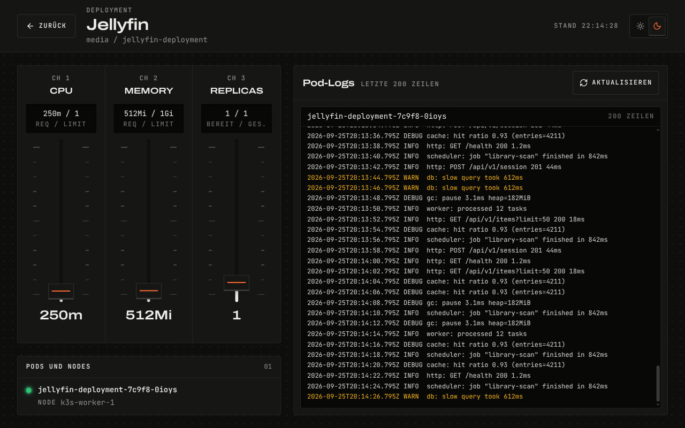

# Rack · Homelab-Dashboard

Selbst gehostete Weboberfläche für ein Homelab. Sie sieht aus wie ein Messgerät aus Aluminium und bündelt drei Bereiche.

- **Power und Status** mit LED, Uptime im 7-Segment-Stil und Power-Knopf
- **System** mit Kennzahlen, CPU-Gauge, Fingerabdruck-Scanner, Sicherheitsschalter für den Hard-Shutdown und vier Zeitreihen aus Prometheus
- **Apps** aus Kubernetes als Module, dazu eine Detailseite pro Deployment mit Fadern für CPU, Memory und Replicas sowie den Pod-Logs

Das Frontend nutzt React 19, Tailwind CSS 4 und shadcn/ui und wird mit Vite gebaut. Das Backend ist Node.js mit Express und WebSockets für Live-Updates.





## Schnellstart

```bash
npm install
npm run dev:mock
```

Danach im Browser `http://localhost:5173` öffnen. Der Mock-Modus erfindet Apps, Messwerte, Pods und Logs, damit das Dashboard ohne Cluster, Prometheus und Raspberry Pi läuft.

| Befehl | Zweck |
|--------|-------|
| `npm run dev` | Vite mit Hot Reload plus Backend gegen die echte Infrastruktur |
| `npm run dev:mock` | Wie `dev`, aber mit Mock-Daten |
| `npm run build` | Typecheck und Produktionsbuild nach `dist/` |
| `npm start` | Backend liefert `dist/` aus (Port 8080) |
| `npm run start:mock` | Wie `start`, aber mit Mock-Daten |
| `npm run typecheck` | Nur TypeScript prüfen |

Im Dev-Modus leitet Vite `/api` und `/ws` an `API_TARGET` weiter (Default `http://localhost:8080`). Ohne vorherigen Build antwortet das Backend auf `/` mit 503 und einem Hinweis.

## Funktionen

| Bereich | Inhalt |
|---------|--------|
| **Apps** | Module nach Namespace gruppiert, Statusübersicht und Filter (Taste `/`). Das Icon öffnet die App, die Leiste darunter öffnet die Detailseite. |
| **Detailseite** | Fader für CPU-Request, Memory-Request und Replicas, Pod-Liste mit Nodes und Pod-Logs. Skalieren auf 0 fragt vorher nach. |
| **System** | Kennzahlen mit Sparklines, CPU-Gauge, vier Zeitreihen, Fingerabdruck-Scanner und Sicherheitsschalter mit Schutzkappe |
| **Power** | LED-Status, Uptime und Power-Knopf mit Bestätigung |
| **Global** | Hell- und Dunkelmodus (gespeichert in `localStorage`), Wechsel zwischen Apps und System per Button oder Wischgeste, Verbindungsanzeige für den WebSocket |

### Fingerabdruck-Zugang

Die Detailseiten sind zum Spass gesperrt. Ein Klick auf eine gesperrte Detail-Leiste führt zum Scanner in der Systemansicht. Nach Scan und Passwort (`FUN_PASSWORD` in `src/dashboard/FingerprintScanner.tsx`) öffnet sich die gewählte Detailseite direkt. Die Freischaltung liegt in `sessionStorage` und wird bei jedem Laden des Dashboards zurückgesetzt. Das ist bewusst keine echte Sicherheitsfunktion.

### Sicherheitsschalter

Die Schutzkappe klappt per Klick auf und schliesst sich nach 5 Sekunden von selbst. Erst bei offener Kappe lässt sich der Hebel umlegen. Danach folgt eine Bestätigung und erst dann geht `POST /api/hard-shutdown` raus.

## Gestaltung

Die Richtung ist ein Industriegerät im Stil von Braun und Teenage Engineering.

- Aluminiumgraue Fläche mit dunkler Schrift, Haarlinien und feinem Punktraster
- Signalorange nur für Live-Zustände und die wichtigste Taste
- Die Farben ok, warn, bad und idle stehen ausschliesslich für Zustände
- Anzeigefenster (Uptime, Scanner, Logs, Fader-Werte) nutzen das Token `screen` und bleiben in beiden Modi dunkel
- Überschriften in Archivo (breit geschnitten), Beschriftungen in JetBrains Mono in Grossbuchstaben
- Diagrammflächen sind schraffiert, der aktuelle Wert ist ein oranger Punkt

Alle Tokens stehen in `src/styles.css` im Block `@theme inline`. Eigene Utilities sind `font-wide`, `label-micro`, `dot-grid`, `hatch` und `scrollbar-thin`. Der Dunkelmodus setzt die Klasse `dark` am `html`-Element. Ein kleines Inline-Skript in beiden HTML-Dateien setzt sie vor dem ersten Rendern, damit nichts aufblitzt. Ohne gespeicherte Wahl gilt `prefers-color-scheme`.

### Responsive und Barrierefreiheit

- Unter 1024px wandert der Ansichtswechsel in eine Leiste am unteren Rand
- Touch-Ziele sind mindestens 44px gross und Texte nie kleiner als 12px
- Alle Bedienelemente haben einen sichtbaren Fokusring und sprechende Labels
- Die Gauge ist ein `meter`, die Fader sind Slider mit Klartextwerten und Statusmeldungen laufen über Live-Regionen
- Dialoge basieren auf Radix und halten den Fokus
- `prefers-reduced-motion` schaltet Animationen ab

Geprüft wurde mit 390×844, 768×1024, 1024, 1280 und 1440 Breite in beiden Farbmodi.

## Projektstruktur

```text
dashboard2/
├── index.html              Einstieg Dashboard
├── app-detail.html         Einstieg Detailseite (leitet ohne Freischaltung auf / um)
├── vite.config.mts         Zwei Einstiege, Alias @ auf src, Dev-Proxy
├── components.json         shadcn-Konfiguration
├── public/img/             Icons und Bilder
├── src/
│   ├── styles.css          Tailwind, Tokens, Utilities, Animationen
│   ├── components/
│   │   ├── ui/             shadcn-Bausteine (Button, Dialog, AlertDialog, Slider, ToggleGroup, Input)
│   │   ├── DialogProvider  Warteschlange für Bestätigungen und Hinweise
│   │   ├── charts          LineChart und Sparkline als SVG
│   │   └── …               Gauge, Led, UptimeDisplay, ThemeToggle, ConnectionBadge
│   ├── lib/                Typen, API-Helfer, WebSocket-Hook, Formatierung, K8s-Zustände
│   ├── dashboard/          DashboardApp, AppsView, SystemView, Power, Scanner, Sicherheitsschalter
│   └── detail/             DetailApp, FaderChannel, PodList, PodLogs
└── server/
    ├── index.js            Express, Auslieferung von dist, WebSocket, Intervalle
    ├── config.js
    ├── mock.js             Mock-Services für MOCK=1
    ├── protocol.js, websocket.js, websocketScopes.js
    ├── routes/registerRoutes.js
    └── services/           pcStatus, prometheus, apps, kubernetes, power
```

Die Datei `apps.yml` wird nicht mehr gelesen. Die App-Liste entsteht aus den Deployments im Cluster.

## Backend

### Apps aus Kubernetes

`appsService` liest alle Deployments ausserhalb der System-Namespaces und sucht die URL über Ingress oder Traefik-IngressRoute. Mit Annotationen am Deployment lässt sich das übersteuern.

| Annotation | Wirkung |
|------------|---------|
| `dashboard.pinned.dev/url` | Feste URL der App |
| `dashboard.pinned.dev/name` | Anzeigename |

Das Icon ist `public/img/icons/<deployment>.png`, wobei die Endungen `-deployment` und `-deploy` wegfallen dürfen. Deployments ohne URL erscheinen nicht.

### Konfiguration

| Variable | Bedeutung |
|----------|-----------|
| `PORT` | HTTP-Port (Default `8080`) |
| `MOCK` | `1` oder `true` schaltet die Mock-Services ein |
| `PC_IP` | Ziel für Status und Prometheus-Fallbacks |
| `PI_IP` | Ziel für Power- und Shutdown-Steuerung |
| `PROMETHEUS_BASE_URL` | Basis-URL von Prometheus |
| `API_TARGET` | Nur für `vite` im Dev-Modus, Ziel des Proxys |

Die Broadcast-Intervalle stehen in `server/config.js` (Status 5 s, Monitoring 2,5 s, Apps 5 s).

### REST-API

| Methode | Pfad | Zweck |
|---------|------|-------|
| `GET` | `/api/status` | PC-Status und Uptime |
| `GET` | `/api/press-button` | Power-Impuls auslösen |
| `POST` | `/api/hard-shutdown` | Hard-Shutdown über den Sicherheitsschalter |
| `GET` | `/api/monitoring/overview` | Monitoring-JSON, Query mit `range` und `step` |
| `GET` | `/api/apps` | App-Liste |
| `GET` | `/api/k8s/deployments` | Deployment-Übersicht |
| `POST` | `/api/k8s/scale` | Body mit `namespace`, `deployment` und `replicas` |
| `POST` | `/api/k8s/resources` | Body mit `namespace`, `deployment` und optional `cpuRequest` oder `memoryRequest` für den ersten Container |
| `GET` | `/api/k8s/pod-logs` | Query mit `namespace`, `deployment` und optional `tailLines` (max. 2000) |

Die Detailseite fragt 200 Logzeilen ab und lädt alle 10 Sekunden neu. Fader speichern erst nach 500 ms Pause und springen bei einem Fehler zurück. Für die Logs braucht der Cluster-Account unter anderem `get` auf `pods` und `pods/log`.

### WebSocket (`/ws`)

- Nach dem Verbinden pusht der Server `status`, `monitoring` und `appsState`
- Danach folgen regelmässige Broadcasts pro Scope
- Der Client schickt `type: "refresh"` mit optionalem `scope` (`status`, `monitoring`, `apps`, `all`)
- Bei Verbindungsabbruch verbindet sich der Client nach 3 Sekunden neu

## Docker

Das Dockerfile baut in zwei Stufen. Die erste Stufe baut das Frontend nativ auf dem Build-Rechner, die zweite enthält nur die Server-Pakete, `server/`, `public/` und `dist/`. Der GitHub-Workflow veröffentlicht das Image für `linux/arm64` unter `ghcr.io/janikhenz/dashboard2:latest`.

```bash
docker build -t dashboard .
docker run --rm -p 8080:8080 -e MOCK=1 dashboard
```

## Lizenz

ISC (siehe `package.json`).
